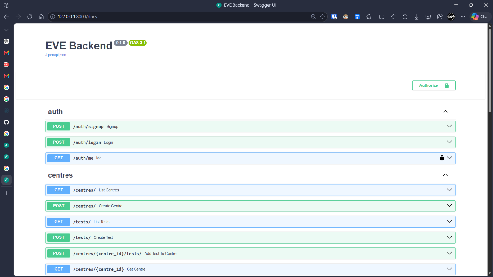

# EVE Backend

Backend service for diagnostic test bookings and simulated payments.

Built with FastAPI, PostgreSQL, SQLAlchemy and Alembic.

## Quick start

Requirements: Docker and Docker Compose.

```bash
git clone https://github.com/ayushHardeniya/eve-backend.git
cd eve-backend
docker compose up --build
```

The API will be available at:

`http://localhost:8000` or `http://127.0.0.1:8000`

Swagger docs:

`http://localhost:8000/docs`



That's it.

## Local development

If you want to run the app without the application container:

```bash
python3 -m venv .venv
source .venv/bin/activate
pip install -r requirements.txt
cp .env.example .env
docker compose up -d db
alembic upgrade head
uvicorn app.main:app --reload
```

## Architecture

live at: https://excalidraw.com/#room=642cc2a929c7d24f98c1,gwoq2Zjysk_SZTwfUXjl_w

## Tech stack

- Python 3.12
- FastAPI
- PostgreSQL
- SQLAlchemy
- Alembic
- Pydantic
- JWT + Argon2
- Pytest
- Ruff
- Docker Compose

## Main APIs

Auth:
- `POST /auth/signup`
- `POST /auth/login`
- `GET /auth/me`

Diagnostic centres and tests:
- `POST /centres/`
- `GET /centres/`
- `GET /centres/{centre_id}`
- `POST /tests/`
- `GET /tests/`
- `POST /centres/{centre_id}/tests/`

Bookings:
- `POST /bookings/`
- `GET /bookings/`
- `GET /bookings/{booking_id}`
- `PATCH /bookings/{booking_id}/cancel`

Payments:
- `POST /payments/`
- `POST /payments/webhook/`

## How it works

A booking is created as `PENDING`. The booking amount is taken from the price configured for that test at the selected centre.

A successful payment changes the booking to `CONFIRMED`. A failed payment changes it to `FAILED`.

Webhook events use a unique event ID, so sending the same event again does not create another payment or change the state again.

## Database

Main tables:

- users
- diagnostic_centres
- diagnostic_tests
- centre_tests
- bookings
- payments
- webhook_events

`centre_tests` connects tests with centres and stores their price.

## Assumptions

- Centre and test management is not restricted to an admin role since the assignment does not define one.
- Payments are simulated, so the payment status is supplied by the request.
- Webhook signature verification is not included because there is no real payment provider.
- A booking can have one payment.

## Testing

```bash
make test
```

or

```bash
pytest -q
```

Tests cover authentication, duplicate signup, protected endpoints, booking creation, successful payment and webhook idempotency.

For linting and formatting:

```bash
make check
```
